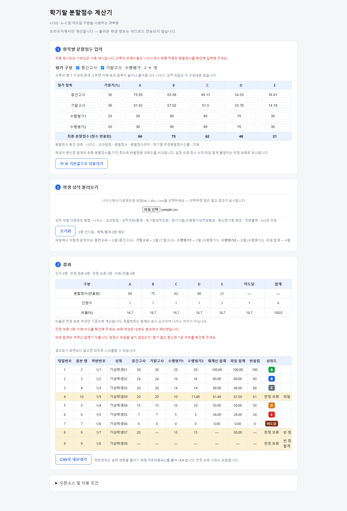

# 학기말 분할점수 계산기

나이스에서 내려받은 **환산점기준 성적 일람표**를 불러와 학기말 분할점수와 학생별 성취도·분포를 확인하는 교사용 도구입니다.

설치 없이 HTML 파일을 브라우저에서 열어 사용합니다. 엑셀 읽기 라이브러리가 포함되어 있어 인터넷 연결이 필요하지 않습니다.

**[실행 파일 다운로드](https://github.com/hzuani/split-score-calculator/releases/latest/download/split-score-calculator.html)** · **[사용 설명서](docs/usage.md)** · **[가상 예제](examples/sample.csv)**

## 사용 방법

1. 위의 실행 파일을 내려받아 Chrome 또는 Edge에서 엽니다.
2. 과목에 맞게 중간고사·기말고사·수행평가 개수를 선택합니다.
3. 반영비율과 항목별 A~E 분할점수를 입력합니다. **처음 표시되는 기본값은 예제입니다.** 나이스에서 최종 적용한 값으로 바꿔 주세요.
4. 나이스 성적 파일을 선택합니다. 시트가 여러 개라면 읽을 시트를 선택합니다.
5. 읽은 평가 열·학생 수·판정 보류 사유를 확인합니다. 필요한 경우 결과를 CSV로 내보냅니다.

처음 사용할 때는 [가상 예제 파일](examples/sample.csv)로 정상 점수·빈 점수·합계 불일치가 어떻게 표시되는지 확인할 수 있습니다. 저장소 전체를 받으려면 **Code → Download ZIP**을 사용하고, 압축을 푼 뒤 `index.html`을 여세요.



## 지원 범위와 계산 기준

- A~E와 E 경계 아래의 ‘미도달’을 구분하는 설정을 지원합니다. 3단계 평정, P/F, 보장지도 이수 처리, 인정점 자동 산출은 지원하지 않습니다.
- 최종 분할점수는 `항목별 분할점수 × 반영비율`을 합산한 뒤 정수로 반올림합니다.
- 학생 점수는 파일의 **환산점**을 합산하고 정수로 반올림한 값으로 성취도를 비교합니다. 학생 점수에 반영비율을 다시 곱하지 않습니다.
- 선택한 구성 순서대로 평가 열을 연결하므로, 결과 위의 **‘파일에서 이렇게 읽었어요’**를 반드시 확인하세요. 모든 나이스 출력 형식을 지원하는 것은 아닙니다.
- 가중치 합·점수 범위·분할점수 순서가 잘못됐거나, 점수가 비었거나, 파일 합계와 재계산 합계가 다르면 ‘판정 보류’로 표시합니다.
- 보류 학생과 자퇴·전출 학생은 성취도 분포에서 제외합니다. 명단과 CSV에는 남깁니다.
- 정렬번호는 합계순 표시 순서입니다. 나이스 석차·석차등급은 산출하지 않습니다.

이 도구는 성적 확인을 돕는 계산기입니다. 적용 과목의 기준과 나이스 최종 결과를 대조해 사용하세요. 현재 기본 계산 방식은 한 학급 34명의 원점수·성취도와 대조해 일치를 확인했으며, 모든 과목·평정 방식의 검증을 뜻하지는 않습니다. 검증에 사용한 실제 학생 자료는 저장소에 포함하지 않습니다.

## 개인정보와 저장

- 불러온 학생 성적을 서버로 보내는 기능이 없습니다. 학생 데이터는 열린 페이지의 메모리에서 처리합니다.
- 평가 구성·분할점수는 브라우저에 저장됩니다. 학생 명단은 브라우저 저장소에 저장하지 않습니다.
- ‘초기화’는 불러온 성적과 결과를 비웁니다. 평가 설정은 유지하며, 설정은 ‘이 표 기본값으로 되돌리기’로 초기화할 수 있습니다.
- CSV로 저장한 결과에는 학생 정보가 포함됩니다. 파일 보관과 공유 범위를 확인하세요.
- 오류를 제보할 때 실제 학생 자료를 첨부하지 마세요. 가상 데이터로 재현하거나 이름·학반번호를 제거해 주세요.

## 개발

사용자는 Node.js가 필요하지 않습니다. 소스 수정과 검증에는 Node.js 18 이상을 사용합니다. 패키지 설치는 필요 없습니다.

```sh
node build.mjs
node build.mjs --check
node tests/calculator.test.cjs
```

`src/app.js`, `src/styles.css`, `src/template.html`을 수정한 뒤 빌드하면 단독 실행 가능한 `index.html`이 생성됩니다. `vendor/xlsx.full.min.js`는 오프라인 엑셀 읽기 라이브러리입니다. `examples/sample.csv`와 자동 검증에는 가상 데이터만 사용합니다.

## 라이선스

계산기 자체 코드는 [MIT License](LICENSE)입니다. 내장된 SheetJS Community Edition 및 코드페이지 데이터에는 [Apache License 2.0](LICENSES/Apache-2.0.txt)이 적용됩니다. [NOTICE](NOTICE)에 저작권과 구성요소를 명시했으며, 단독 HTML에도 이용 조건을 포함했습니다.

SheetJS 라이선스 안내: https://docs.sheetjs.com/docs/miscellany/license/
